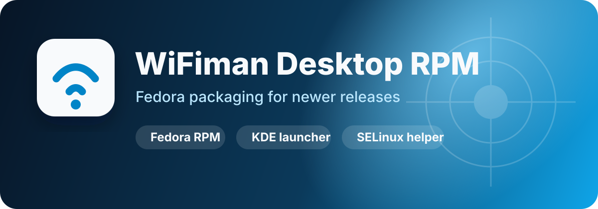

# WiFiman Desktop RPM for Fedora



[](https://github.com/iamstevedavis/wifiman-rpm/actions/workflows/release.yml)
[](https://github.com/iamstevedavis/wifiman-rpm/releases/latest)


Fedora RPM packaging for **WiFiman Desktop 1.3.0**, with a KDE/app-menu launcher, system WebKitGTK 4.1 runtime, release artifacts, and SELinux helper tooling for newer Fedora releases.

Upstream 1.3.0 links against the system WebKitGTK 4.1 / libsoup3 stack, so this package no longer stages a private compatibility runtime. The RPM build also disables the upstream in-app updater scope so the packaged app does not offer to install an upstream `.deb`; update WiFiman through `dnf` instead.

## Highlights

- Downloadable versioned RPMs from GitHub Releases
- KDE / desktop launcher named **WiFiman Desktop**
- Terminal launcher command: `wifiman-desktop`
- System WebKitGTK 4.1 / libsoup3 runtime from Fedora
- Optional SELinux policy helper for daemon networking denials
- Local helper scripts for clean reinstall, launch, and debug log collection

## Install the release RPM on Fedora

Most users should install the prebuilt release RPM instead of building from source.

1. Download the latest `wifiman-desktop-*-x86_64.rpm` from the [GitHub Releases page](https://github.com/iamstevedavis/wifiman-rpm/releases).
2. Install it with DNF:

```bash
sudo dnf install ./wifiman-desktop-1.3.0-1.fc44.x86_64.rpm
```

3. Launch it from KDE / your Applications menu as **WiFiman Desktop**, or from a terminal:

```bash
wifiman-desktop
```

The SELinux helper is **not required for installation**. Start with the RPM install and app launch above. Only run `./scripts/install-selinux-policy.sh` later if the daemon/app is blocked by SELinux denials on an enforcing Fedora system. See [SELinux policy helper](#selinux-policy-helper) for details.

## Deep links (Teleport invites)

WiFiman Desktop handles `wifiman-desktop-dl://` links. Starting the app once
installs or repairs a per-user handler at
`${XDG_DATA_HOME:-~/.local/share}/applications/wi-fiman-desktop-bin-handler.desktop`
and makes it the default for the scheme. The handler runs `/usr/bin/wifiman-desktop`,
so invites start through the packaged launcher instead of the raw UI binary
that upstream's Tauri deep-link plugin registers.

This is intentional and not configurable: the launcher re-asserts the managed
handler on every start so a stale or raw handler cannot take over. If another
application has taken the scheme, start **WiFiman Desktop** once to repair it,
or set the managed handler manually:

```bash
xdg-mime default wi-fiman-desktop-bin-handler.desktop x-scheme-handler/wifiman-desktop-dl
```

## What this repo does

This project repackages WiFiman Desktop for Fedora users who want a native RPM install path on newer Fedora/KDE systems.

- downloads upstream `wifiman-desktop-1.3.0-amd64.deb`
- extracts the app payload
- stages a runnable app tree with a wrapper
- disables the in-app updater scope in the staged Tauri app
- builds an RPM from that staged tree using the host WebKitGTK 4.1 stack

## Updater behavior

WiFiman Desktop checks for updates from its Tauri frontend by fetching `https://desktop.ea.wifiman.com/wifiman-desktop-linux-manifest.json`. The packaged `.env` `UPDATER_DELAY` and `UPDATER_INTERVAL` values are not read by the shipped binaries, so changing them does not suppress the prompt.

The staging step rewrites the embedded `tauri-plugin-http` scope entry for that CDN to the reserved, non-resolving `https://updater-block9.invalid/*` host. The frontend request is then rejected locally and the update prompt does not appear. Install updates from the RPM repository with `dnf`.

Because this is a binary patch, re-validate it whenever the upstream version changes. Staging fails loudly if the expected scope entry is missing or appears more than once, rather than silently shipping an updater that works again. To inspect an extracted upstream binary:

```bash
python3 scripts/patch-wifiman-updater-scope.py --check /path/to/usr/bin/wifiman-desktop
```

The check succeeds only when exactly one patched or unpatched scope entry is present.

## Requirements

On Fedora:

```bash
sudo dnf install -y docker git policycoreutils-python-utils setools-console
sudo systemctl enable --now docker
```

Your user also needs Docker access:

```bash
sudo usermod -aG docker "$USER"
newgrp docker
```

## Quick build

From the repo root:

```bash
./scripts/build-rpm-from-stage.sh
```

That script now:

1. rebuilds the stage by default
2. validates the required staged files exist
3. builds the RPM in a Fedora 44 container

Artifacts are written to:

```bash
./.rpmbuild/RPMS
./.rpmbuild/SRPMS
```

## Step-by-step build and test

### 1) Build the staged app tree

```bash
./scripts/stage-wifiman-fedora-newer.sh
# defaults to upstream 1.3.0 unless UPSTREAM_VERSION is overridden
```

### 2) Verify library resolution locally

```bash
./scripts/verify-fedora-newer-stage.sh
```

### 2.5) Run the local test suite

```bash
./tests/run-all.sh
```

The RPM launcher and daemon wrapper share `scripts/wifiman-runtime.sh` for
selective runtime mirroring, configuration persistence, and log paths. The RPM
installs this helper under `/usr/lib/wi-fiman-desktop`; it is not mirrored into
mutable state. The launcher retains per-user XDG state, while the daemon uses
`/var/lib/wifiman-desktop`. Tests cover both installed wrapper locations,
configuration recovery and persistence, and the launcher runtime
environment.
The installed-layout smoke test uses mock binaries, not a real Fedora GUI launch.

Daemon logs remain at `/var/lib/wifiman-desktop/wifiman-desktop.log`. The
packaged `/usr/lib/wi-fiman-desktop/wifiman-desktop.log` compatibility symlink
uses a relative target to avoid RPM's absolute-symlink warning. It is not
mirrored into runtime state; both wrappers select their log file via `LOG_PATH`.

The private `/usr/lib/wi-fiman-desktop` spelling is intentionally retained for
compatibility; public names remain `wifiman-desktop`. No path migration or clean
reinstall is required. See the [internal path audit and decision](docs/internal-paths.md)
for the upstream, systemd, runtime and SELinux implications.

The runtime copy of `wg-quick` is patched to cap the auto-detected tunnel MTU at
**1280** (the IPv6 minimum) instead of the route-derived value (often 1420).
Cellular and hotspot paths commonly have a path MTU around 1190, where larger
packets (TLS handshakes, page loads) are silently dropped while small ones
still work. An explicit `MTU =` in the WireGuard config still wins. The
packaged `/usr/lib/wi-fiman-desktop/wg-quick` is never modified, the patch is
idempotent and fails soft (leaving the copy untouched with a warning) if
upstream `wg-quick` changes. Set `WIFIMAN_WG_MTU_CAP` in the daemon
environment to override the cap; `WIFIMAN_WG_MTU_CAP=0` disables it. The value
is read when the daemon starts, so set it with a systemd drop-in:
`sudo systemctl edit wifiman-desktop` then add
`[Service]` / `Environment=WIFIMAN_WG_MTU_CAP=1300` and restart the service.
Values below 1280 are raised to 1280: Linux drops IPv6 on smaller links, and
the daemon's tunnel health check uses IPv6.

### 3) Test against a Fedora container

```bash
./scripts/test-fedora-newer-stage-in-container.sh
```

### 4) Build the RPM

```bash
./scripts/build-rpm-from-stage.sh
```

### 5) Inspect the artifacts

```bash
find ./.rpmbuild/RPMS ./.rpmbuild/SRPMS -type f | sort
```


## Release builds

The GitHub Actions release workflow builds versioned RPM artifacts and publishes them as downloadable assets.

The package version follows the upstream WiFiman Desktop version. The RPM release number counts packaging-only rebuilds of the same upstream version.

- Push a semantic-version tag like `v1.3.0` to release upstream 1.3.0 as RPM release 1.
- Push `vX.Y.Z-N` (e.g. `v1.3.0-2`) to ship packaging fixes on the same upstream version as RPM release `N`.
- Or run the **release** workflow manually with `version`, `rpm_release`, and `create_release=true`. It tags the release `vVERSION-RELEASE` (e.g. `v1.3.0-2`) and fails if that tag already exists, unless `overwrite=true`. `upstream_version` defaults to `version`.

Version and tag handling lives in `scripts/release-version.sh` and is covered by `tests/test-release-version.sh`.

The **test** workflow runs `./tests/run-all.sh` on every pull request and on pushes to `develop`.

The workflow uploads:

- binary RPM from `.rpmbuild/RPMS`
- source RPM from `.rpmbuild/SRPMS`
- SHA256 checksum file

Release notes include the upstream WiFiman Desktop version and RPM install commands.

## Clean removal / install helper scripts

For a clean local reinstall, remove the package, service, and runtime state:

```bash
./scripts/remove-wifiman-desktop.sh
```

By default this removes `/var/lib/wifiman-desktop` and the current user's WiFiman state under `${XDG_STATE_HOME:-~/.local/state}`. It keeps local SELinux modules unless explicitly requested:

```bash
REMOVE_SELINUX_MODULES=1 ./scripts/remove-wifiman-desktop.sh
```

That removes the two modules installed by `./scripts/install-selinux-policy.sh` — `wifiman-desktop` and `wifiman_desktop_local` — at their install priority `300`, and fails loudly if a present module cannot be removed. The installer/remover names and priority can be overridden together with the same `BASE_MODULE_NAME`, `AVC_MODULE_NAME`, and `SELINUX_MODULE_PRIORITY` variables.

Build, install, and start the service in one command:

```bash
./scripts/install-and-run-wifiman-desktop.sh
```

Useful overrides:

```bash
RPM_PATH=/path/to/wifiman-desktop.rpm BUILD_RPM=0 ./scripts/install-and-run-wifiman-desktop.sh
INSTALL_SELINUX_POLICY=1 ./scripts/install-and-run-wifiman-desktop.sh
LAUNCH_APP=1 ./scripts/install-and-run-wifiman-desktop.sh
DNF_REFRESH=0 ./scripts/install-and-run-wifiman-desktop.sh
DNF_CLEAN_METADATA=0 ./scripts/install-and-run-wifiman-desktop.sh
```

Collect diagnostics to paste into an issue/chat:

```bash
./scripts/collect-wifiman-debug-logs.sh
```

The log bundle is written to `/tmp/wifiman-debug.log` by default.

## SELinux policy helper

The upstream daemon uses raw ICMP / raw socket operations for device discovery and related networking behavior. On Fedora with SELinux enforcing, that can trigger denials until a local policy module is installed.

This package now seeds a minimal valid `service.json` so the daemon does not crash on first run due to an empty config file, redirects logs into `/var/lib/wifiman-desktop`, and runs from a writable runtime mirror so upstream writes to `service.json(.tmp)` land under `/var/lib/wifiman-desktop` instead of the packaged `/usr/lib/wi-fiman-desktop` tree.

Enable the daemon once so SELinux has something to audit:

```bash
sudo systemctl enable --now wifiman-desktop.service
```

If SELinux blocks the daemon, first distinguish packaging/wrapper errors from AVC denials. **The existing base policy grants permissions to shared `init_t` and generic file labels, not just WiFiman.** Its dedicated-domain replacement is pending [issue #15](https://github.com/iamstevedavis/wifiman-rpm/issues/15). See the [scope audit and enforcing-Fedora checklist](docs/selinux-validation.md) before opting into this workaround:

```bash
./scripts/install-selinux-policy.sh
```

That helper is only needed when SELinux is enforcing and the daemon gets denied. It:

- re-runs itself with `sudo` when needed
- compiles the repo-managed base policy from `scripts/wifiman-desktop.te`
- installs that policy as the `wifiman-desktop` SELinux module with priority `300`
- checks recent audit logs for `wifiman-desktop` AVC denials
- saves AVC evidence and a draft `wifiman_desktop_local` source in a root-only directory under `/var/tmp`, **without installing it**
- restarts `wifiman-desktop.service`
- prints the resulting service status

The helper does not change SELinux mode or disable enforcement. Filtering audit records by process name does **not** confine an allow rule to that process. Review every source type, target type, class and permission against the reproduced failure; reject unrelated denials and shared-label broadening. Existing AVC modules are left unchanged, so review previously installed modules too.

After reviewing/editing the saved source, explicitly install it (substitute the printed path):

```bash
sudo env REVIEWED_AVC_TE=/var/tmp/wifiman-selinux-review.XXXXXX/wifiman_desktop_local.te ./scripts/install-selinux-policy.sh
```

This compiles the reviewed source, not a previously generated binary module, and prints it before installation. Keep the source/evidence for the review record; remove the saved directory when no longer needed. Do not share unredacted audit logs.

If you need a wider audit window, you can override the time filter:

```bash
SINCE=boot ./scripts/install-selinux-policy.sh
```

## Notes

- this packaging path currently targets `x86_64`
- the build uses Docker internally
- on SELinux-enforcing Fedora hosts, the RPM build container bind mount is labeled with `:Z`
- host EGL / GLVND and WebKitGTK 4.1 pieces are provided by the Fedora system
- the RPM no longer installs a private WebKit injected bundle or `webkit2gtk-4.0` helper files
- the daemon SELinux policy helper now includes a repo-managed base policy plus optional local AVC-derived deltas; it is still a local-machine workaround, not an upstream Fedora policy integration yet

## Agent / automation notes

Repo-local guidance for AI agents and automation lives in `AGENTS.md`.

## Repo status

This repo is focused on the local newer-Fedora packaging path and the direct build/test/install flow for Fedora.

## Repo layout

- `scripts/` — build, staging, wrapper, and SELinux helper scripts
- `tests/` — local regression tests and the `run-all.sh` test runner
- `wifiman-desktop.spec` — RPM spec file
- `FEDORA_NEWER_NOTES.md` — extra packaging notes and context
- `AGENTS.md` — repo-specific guidance for AI agents and automation
